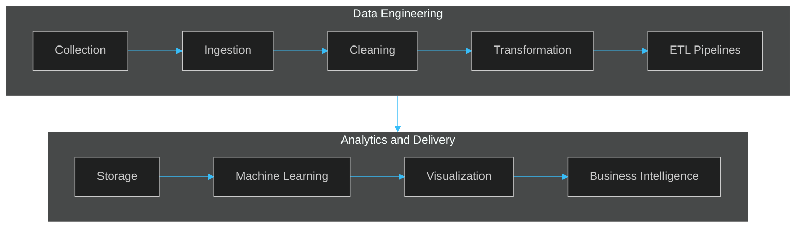

<!--
  TO REPLACE BEFORE PUBLISHING (Ctrl+F):
  YOUR_USERNAME        -> your GitHub username
  YOUR_EMAIL           -> your professional email
  YOUR_LINKEDIN_ID     -> your LinkedIn profile id
  REPO_IMMOTRACK / REPO_REVIEWANALYZER / REPO_GED -> real repository names
  "Currently learning" -> keep only what is true
-->

 

  
  
  

DUT in Data Engineering (2024–2026) · Bachelor in Data Science (2026–2027) · EST Kelaâ des Sraghna, Morocco

 

## About

I'm a Data Engineering student who builds complete applications around data. My studies cover the data lifecycle, from collection and cleaning to storage and modeling, and my projects connect that work to real interfaces, APIs and databases.

I enjoy working across the whole stack:

- **Web applications** — responsive interfaces and clean user experiences
- **Backend and APIs** — application logic, REST APIs and service architecture
- **Databases** — relational design and SQL
- **Data pipelines** — web scraping, cleaning, processing and ETL
- **Machine Learning and analytics** — predictive models, visualization and reporting

I'm continuously developing my skills in Data Engineering and Data Science, and I'm looking for opportunities to learn and contribute on real projects.

 

## Technical Skills

<table>
  <tr>
    <td width="220"><b>Full-Stack Development</b></td>
    <td>
       
      <code>REST APIs</code>
    </td>
  </tr>
  <tr>
    <td><b>Data Engineering</b></td>
    <td>
       
      <code>SQL</code> <code>ETL</code> <code>Web Scraping</code> <code>Data Cleaning</code> <code>Data Processing</code>
    </td>
  </tr>
  <tr>
    <td><b>Data Science &amp; ML</b></td>
    <td><code>Machine Learning</code> <code>Predictive Modeling</code> <code>Statistics</code> <code>Data Analysis</code></td>
  </tr>
  <tr>
    <td><b>Data Visualization</b></td>
    <td>
      
      
      
    </td>
  </tr>
  <tr>
    <td><b>Tools &amp; Infrastructure</b></td>
    <td></td>
  </tr>
  <tr>
    <td><b>Currently learning</b></td>
    <td><code>Data Warehousing</code> <code>Data Mining</code></td>
  </tr>
</table>

 

## Featured Projects

### ImmoTrack — Real Estate Intelligence Platform

> A data-driven platform that collects, processes, analyzes and evaluates Moroccan real estate listings to support investment decisions.

- Web scraping from multiple real estate platforms
- Data cleaning, preprocessing and data quality assessment
- Machine Learning models for price prediction
- Investment opportunity scoring
- Interactive dashboards backed by a PostgreSQL database

 

[View repository](https://github.com/YOUR_USERNAME/REPO_IMMOTRACK)

 

### ReviewAnalyzer — Customer Reviews Analysis &amp; Automatic Reporting

> An application that processes customer reviews and generates analytical reports automatically.

- Customer review processing
- Rule-based sentiment analysis
- Satisfaction analysis by service category
- Interactive data visualization
- Automatic PDF report generation

 

[View repository](https://github.com/YOUR_USERNAME/REPO_REVIEWANALYZER)

 

### GED — Electronic Document Management System

> A web application to organize, manage and centralize electronic documents.

- Electronic document management and organization
- Backend development
- MySQL database integration

[View repository](https://github.com/YOUR_USERNAME/REPO_GED)

 

## Data Engineering Lifecycle

The workflow I'm building skills in, from raw data to decisions.

 

## Education &amp; Experience

<table>
  <tr>
    <td width="130"><b>2024 – 2026</b></td>
    <td><b>DUT – Ingénierie des Données</b> École Supérieure de Technologie de Kelaâ des Sraghna</td>
  </tr>
  <tr>
    <td><b>2026 – 2027</b></td>
    <td><b>Bachelor – Sciences des Données</b> École Supérieure de Technologie de Kelaâ des Sraghna</td>
  </tr>
  <tr>
    <td><b>Internship</b></td>
    <td><b>MyDeveloper</b> — ImmoTrack project Dates and responsibilities to be added</td>
  </tr>
</table>

 

## GitHub Analytics

If a card does not load, the services are temporarily busy. See my <a href="https://github.com/YOUR_USERNAME">GitHub profile</a> for live activity.

 

## Let's Connect

I'm open to internships and collaborative projects in full-stack development and data engineering. If you're working on something interesting, I'd be glad to talk.

